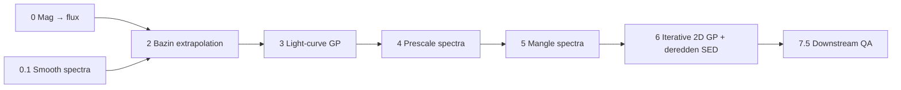

# kn-sed-pipeline

Building time-evolving spectral energy distribution (SED) templates for kilonovae and other transients from multi-band photometry and sparse spectroscopy.

This repository is a log-space reconstruction pipeline. It fits each photometric band with a one-dimensional Gaussian Process, aligns multi-arm spectroscopy onto a common flux scale, applies wavelength-dependent mangling so that synthetic photometry matches the light-curve fit, and then iterates a two-dimensional Gaussian Process over wavelength and phase until the mangling and the surface converge. The default worked example is **AT2017gfo** (the optical counterpart of GW170817).

For day-to-day operational detail (every flag, input column, and output path), see the [Pipeline User Guide](docs/PIPELINE_USER_GUIDE.md). For the scientific equations and rationale behind each stage, see the [Pipeline Writeup](docs/PIPELINE_WRITEUP.md) (PDF: [PIPELINE_WRITEUP.pdf](docs/PIPELINE_WRITEUP.pdf)).

---

## Documentation

| Document | Description |
|----------|-------------|
| [**User guide (full)**](docs/PIPELINE_USER_GUIDE.md) | Step-by-step run instructions, input formats, notebooks, scripts, configuration, troubleshooting |
| [PDF user guide](docs/PIPELINE_USER_GUIDE.pdf) | Offline copy — build with `docs/build_user_guide_pdf.sh` (needs pandoc) |
| [**Scientific writeup**](docs/PIPELINE_WRITEUP.md) | Equations and scientific description of every pipeline stage |
| [PDF writeup](docs/PIPELINE_WRITEUP.pdf) | Offline copy — build with `docs/build_writeup_pdf.sh` (needs pandoc and pdflatex) |
| [Prescale (step 4)](Codes/helper_scripts/docs/PHASE1_PRESCALE.md) | Scale groups, seams, and arm bridging |
| [Iterative GP (step 6)](Codes/helper_scripts/docs/PHASE3_ITER_GP_MANGLE.md) | Outer-loop internals and convergence |
| [Iterative data flow](Codes/helper_scripts/docs/ITERATIVE_MANGLING_DATA_FLOW.md) | Physical inputs and outputs of each remangle iteration |
| [Downstream QA](Codes/helper_scripts/docs/PHASE4_DOWNSTREAM_QA.md) | How notebooks 7.5 read final products |
| [Deprecated modules](Codes/helper_scripts/docs/DEPRECATED_REMOVED.md) | Removed or superseded code log |

---

## What you will need

- **Python 3.10 or newer** (3.12 is tested).
- The packages listed in [`requirements.txt`](requirements.txt). The most important non-standard dependency is **george** (Gaussian Process library, version 0.4.3 or newer; see https://george.readthedocs.io/). You will also need numpy, scipy, pandas, matplotlib, astropy, extinction, synphot, and jupyter for the preparation notebooks.
- An environment variable **`COCO_PATH`** pointing at the root of this cloned repository (the folder that contains `Codes/`, `Inputs/`, and `Outputs/`).

---

## Build your own template: instructions

### STEP 0: Clone the repository and set up the environment

1. Clone this repository to a convenient location on your machine.
2. Set the environment variable `COCO_PATH` to that location. For example:

```bash
export COCO_PATH="/path/to/kn-sed-pipeline"
```

Add the same line to your shell startup file (`.bashrc`, `.zshrc`, and so on) if you want it to persist across sessions.

3. Create a virtual environment and install dependencies:

```bash
cd "$COCO_PATH"
python -m venv .venv
source .venv/bin/activate
pip install -r requirements.txt
```

4. (Optional, recommended for servers or batch runs.) Force matplotlib to use a non-interactive backend so plots can be written without a display:

```bash
export MPLBACKEND=Agg
```

The production scripts under `Codes/` already set this where needed, but setting it in your shell avoids surprises when you import plotting helpers interactively.

---

### STEP 1: Prepare inputs

All inputs (photometry, spectroscopy, filter transmission curves, and supernova metadata) live under `./Inputs`. You need to prepare three kinds of data before you start running the production scripts. The AT2017gfo example already shipped in this repository illustrates the expected formats.

#### 1. Photometry

Start from **AB magnitudes** in the filter system each measurement was reported in (Swope, DECam, GROND, …). **Step 0** (`Codes/0_Mag_to_Flux_KN.py`) builds the raw photometry file from a compiled-photometry JSON (`--from-json`), or recomputes the fluxes of an existing raw file (`--redo-fluxes`), always converting magnitudes to fluxes at each filter's pivot wavelength (see [Magnitudes and fluxes](#magnitudes-and-fluxes-step-0) below). The pipeline then uses these stages in order:

| Folder | Role |
|--------|------|
| `Inputs/Photometry/1_LCs_flux_raw/` | Observed AB magnitudes and the step-0 band fluxes, **not dust-corrected** (input to notebook 2; also used to build band Modified Julian Date windows) |
| `Inputs/Photometry/3_LCs_extrapolated/` | Early- and late-time extrapolated light curves written by notebook 2, still as observed; **this is the input to step 3** |

The photometry and spectra are never dereddened before fitting. Milky Way and host dust are removed only from the final SED, at the end of step 6 (see [Dust](#dust)).

Each light-curve file is named `<SN>.dat` (for example `AT2017gfo.dat`). After notebook 2, a typical extrapolated file has a header row and columns such as:

```text
MJD  band  Flux  Flux_err  FilterSet  Instr  Phase  Log_Phase  Log_Flux  Log_Flux_err
```

A raw file under `1_LCs_flux_raw/` is comma-separated and looks like:

```text
MJD,Mag,Mag_err,Flux,Flux_err,band,Instr,FilterSet,MagSys
57982.981,17.48,0.02,1.89987296516e-16,3.49969533452e-18,Swope_i,E2V4kx4kccd,GeneralFilters,AB
57984.751,19.06,0.07,9.11356117414e-17,5.87573002903e-18,Sinistro_V,Sinistro,GeneralFilters,Vega
```

`band` must match a filter file `Inputs/Filters/<FilterSet>/<band>.dat`. Files written by step 0 end with a **`MagSys`** column (`AB` or `Vega`) giving the system of `Mag`; it is optional, and a missing column or blank value means AB. `Flux`/`Flux_err` (erg s⁻¹ cm⁻² Å⁻¹) are always written by step 0. You can either let step 0 create this file from a JSON (below), or write `MJD`, `Mag`, `Mag_err`, `band`, `Instr`, `FilterSet` (and `MagSys` if any are Vega) yourself, with placeholder `Flux`/`Flux_err`, and run `--redo-fluxes`. Notebook 2 and steps 3–6 read only `MJD`, `band`, `Flux`, `Flux_err` (and pass `FilterSet`/`Instr` through), so the extra column does not affect them. Only QA code reads `Mag` (notebooks 7.5/7.6, `comparison_trapz_lc.py`, `plotting-final.ipynb`); 7.6 reports synthetic magnitudes in each row's own system (`mag_<x>_insys`), while the 7.5 notebooks and `plotting-final.ipynb` still plot `Mag` as AB, which is off by $m_{AB}-m_{\rm Vega}$ for Vega rows (about $-0.01$ mag for the current Sinistro $V$ points).

**Compiled-photometry JSON (recommended source).** A list of records, one per observation, with at least `MJD`, `Telescope`, `Instrument`, `Filter`, `Villar Mag`, `Villar Mag_err`, and `AB/VEGA/Etc` (the `KN_SED_Data*.json` layout; other magnitude keys via `--mag-key`/`--mag-err-key`). Magnitudes are used **exactly as given**: whether Galactic/host extinction has been removed from them must be decided in the JSON *before* step 0 (the pipeline expects **un-dereddened** magnitudes, because dust is removed from the final SED at the end of step 6). Step 0 then:

- maps each row to a filter curve `<Instrument>_<Filter>`, else `<Telescope>_<Filter>` (exact match first, then case-insensitive, e.g. `omegacam_g` → `OmegaCam_g.dat`);
- keeps **Vega** magnitudes in Vega (`MagSys = Vega`) and computes their flux from the Vega zero point, using the Vega spectrum `Inputs/Standards/alpha_lyr_stis_006.fits` (CALSPEC; Vega = 0 mag in every band; override with `--vega-spectrum`);
- drops rows without a numeric MJD/magnitude/error, upper limits, other magnitude systems, and rows with no matching filter curve — add the missing curve to `Inputs/Filters/GeneralFilters/` to keep them;
- with `--drop-repeated`, drops rows marked `R` in `Repeated obs` (the same measurement copied from another paper) and keeps everything else; with `--villar-used-only`, keeps only rows marked `*` in `Used in Villar model?`;
- keeps rows with no magnitude system (`-`) as AB, and rows that repeat an MJD+band (the same epoch from several papers), but **flags** both;
- skips a repeated CSV header record if the JSON has one;
- writes the per-row decisions to `Outputs/<SN>/<SN>_step0_json_rows.csv` and prints a summary.

##### Magnitudes and fluxes (step 0)

The pipeline compares data and model as **band-integrated** quantities. The mangling step fits the photon-weighted band-mean flux $\langle f_\lambda\rangle = \int f_\lambda S\lambda\,d\lambda / \int S\lambda\,d\lambda$, where $S(\lambda)$ is the photon-counting throughput in the filter file, and synthetic AB magnitudes use the same (standard, photon-counting) AB definition. For an AB magnitude this band mean is exact and independent of the source SED:

$$\langle f_\lambda\rangle = 3631\,\mathrm{Jy}\times 10^{-0.4\,m_{AB}}\,\frac{c}{\lambda_{\rm piv}^2},\qquad \lambda_{\rm piv}=\sqrt{\frac{\int S\lambda\,d\lambda}{\int S/\lambda\,d\lambda}}$$

with $\sigma_F = F\cdot 0.4\ln 10\cdot\sigma_m$. Step 0 applies exactly this at each filter's **pivot** wavelength. Do **not** convert at an "effective", mean, or median wavelength — those give fluxes inconsistent with the rest of the pipeline (an earlier version of the AT2017gfo input used a blue-shifted wavelength and was 0.07–0.6 mag too bright; see issue #3). For rows with `MagSys = Vega` the zero point is Vega instead: $\langle f_\lambda\rangle = 10^{-0.4\,m_{\rm Vega}}\,\langle f^{\rm Vega}_\lambda\rangle$, which equals the AB formula applied to $m_{\rm Vega} + (m_{AB}-m_{\rm Vega})$ with the exact, SED-independent band offset $m_{AB}-m_{\rm Vega}=-2.5\log_{10}\langle f^{\rm Vega}_\lambda\rangle/\langle f^{AB}_\lambda\rangle$. The flux is the same whether a point is stored in Vega or converted to AB; only the `Mag` column differs. Other systems are rejected.

Step 0 has three modes (exactly one is required):

```bash
cd "$COCO_PATH/Codes"
# build 1_LCs_flux_raw/<SN>.dat from a compiled-photometry JSON
python 0_Mag_to_Flux_KN.py --snname AT2017gfo --from-json /path/to/KN_SED_DATA_dust_corrected.json
# keep an existing raw .dat as is, recompute only Flux/Flux_err (no format change)
python 0_Mag_to_Flux_KN.py --snname AT2017gfo --redo-fluxes --overwrite
# verify only; exits 1 if any Flux is stale; never writes
python 0_Mag_to_Flux_KN.py --snname AT2017gfo --check
```

> **⚠️ Back up before writing.** `--from-json` and `--redo-fluxes` write `Inputs/Photometry/1_LCs_flux_raw/<SN>.dat` by default. If that file already exists the script **refuses to run** unless you pass `--overwrite`. **Rename the old file first** (e.g. `mv AT2017gfo.dat AT2017gfo_old.dat`) so nothing is lost, or write elsewhere with `--output`.

Run step 0 whenever the photometry or any filter curve changes, and `--check` it before every run. Use `--input` to check or redo a raw file at another path. For JSON input, `--drop-repeated` removes only rows flagged as repeated observations (`R`), while `--villar-used-only` keeps only the rows Villar et al. used (which also drops rows excluded for other reasons).

**If your photometry is already extended at early and late times** (or you do not want that step), you may skip notebook 2 and place the finished light curve directly in `Inputs/Photometry/3_LCs_extrapolated/<SN>.dat`. Its fluxes must follow the same pivot-wavelength AB convention as step 0 and must **not** be dust-corrected. You still need a raw file under `1_LCs_flux_raw/` so that step 5 can build per-band Modified Julian Date validity windows when they are missing.

#### 2. Spectroscopy

For each transient you need:

1. A **spectrum list** file under `Inputs/Spectroscopy/1_spec_lists_original/` (or, after smoothing, under `2_spec_lists_smoothed/`).
2. The **spectrum data files** themselves under `Inputs/Spectroscopy/1_spec_original/<SN>/` (or `2_spec_smoothed/<SN>/` after notebook 0.1).

Each list file is named `<SN>.list` and has three whitespace-separated columns: Modified Julian Date, phase in days since explosion (often filled later), and the absolute or repository-relative path to the spectrum file. Example:

```text
57983.018250	0.000000	/path/to/Inputs/Spectroscopy/2_spec_smoothed/AT2017gfo/57983.01825_LDSS3_Magellan.dat
57983.969001	0.950751	/path/to/.../NIR_AT2017gfo_ENGRAVE_v1.0_XSHOOTER_MJD-57983.969001_Phase+1.43d.dat
```

Each spectrum file is a simple ASCII table with wavelength in angstroms, flux, and flux error. Example:

```text
#wls	flux	flux_err
3725.6000	1.8021e-15	4.1786e-16
3727.6000	1.7594e-15	4.1786e-16
```

XSHOOTER arms are typically named with `UVB_`, `VIS_`, or `NIR_` prefixes so that step 4 can group them. Single-arm instruments such as LDSS3 appear as one file per epoch.

**If you do not want to smooth**, skip notebook 0.1 and place both the list and the spectra under the smoothed folders (`2_spec_lists_smoothed/` and `2_spec_smoothed/`).

After step 4, the pipeline writes **prescaled** spectra to `Inputs/Spectroscopy/2_spec_prescaled/<SN>/` and a matching list under `2_spec_lists_prescaled/`. Steps 5 and 6 read those by default.

#### 3. Supernova metadata and configuration

- Edit or extend `Inputs/SNe_Info/info.dat` with a row for each new transient: redshift `z`, coordinates, type fields, and the dust parameters `EBV_MW`, `EBV_host`, `RV_MW`, `RV_host`. All four dust columns are required; step 6 stops before fitting if any is missing (see [Dust](#dust)).
- Set the explosion (or merger) Modified Julian Date and redshift in [`Codes/pipeline_config.py`](Codes/pipeline_config.py) under `SN_EXPLOSION_MJD` and `SN_REDSHIFT`. For AT2017gfo these are already filled in.
- Optionally set how long the final SED should cover in `SED_TIME_RANGE` (per supernova, `(start, end)`), in days since explosion or in MJD (`SED_TIME_RANGE_UNIT = "phase"` or `"mjd"`). Either end can be `None`. The range is never narrower than the data: by default the final SED runs from the first to the last spectrum or photometry epoch, and a range past the data is kept, with a warning, and filled by Gaussian Process extrapolation. Step 3 sets this span, and steps 4 to 6 follow it, so rerun from step 3 after changing it.
- Filter transmission curves live under `Inputs/Filters/GeneralFilters/`. Band colors, markers, and exclusion lists for plots are controlled by [`Codes/filter_plot_config.json`](Codes/filter_plot_config.json).

#### 4. Optional two-dimensional prior

The folder `Inputs/2DIM_priors/` holds surface priors used by the two-dimensional Gaussian Process. The default iteration path uses a flat prior unless you point `ITER_GP_PRIOR_FILE` in `pipeline_config.py` at another file.

---

### STEP 2: Run the pipeline

All outputs (light-curve fits, mangled spectra, diagnostic plots, and the final SED surface) are written under `Outputs/<SN>/`. Preparation notebooks live in `Codes/` alongside the production Python drivers. A typical notebook is organized as: path and import cells, configuration cells, then run and save cells.

The overall flow is:



- Script **0** converts the raw AB magnitudes to band fluxes (run it, or `--check` it, first).
- Notebooks **0.1 → 2** prepare smoothed spectra and extrapolated photometry (both as observed).
- Scripts **3 → 4 → 5 → 6** are the production chain you re-run most often.
- Notebooks **7.5** and related scripts inspect the final products.

#### Step 0: magnitudes to fluxes (always first)

```bash
cd "$COCO_PATH/Codes"
python 0_Mag_to_Flux_KN.py --snname AT2017gfo --check
```

If the check fails, or you have new photometry, (re)build the raw file — **after renaming the old one**:

```bash
mv ../Inputs/Photometry/1_LCs_flux_raw/AT2017gfo.dat ../Inputs/Photometry/1_LCs_flux_raw/AT2017gfo_old.dat
python 0_Mag_to_Flux_KN.py --snname AT2017gfo --from-json /path/to/photometry.json
# or, to keep the existing rows and only fix the fluxes:
python 0_Mag_to_Flux_KN.py --snname AT2017gfo --redo-fluxes --input ../Inputs/Photometry/1_LCs_flux_raw/AT2017gfo_old.dat
```

If step 0 changes the raw file, everything downstream of it is stale: re-run notebook 2 and then steps 3–6.

> **AT2017gfo note (October 2026).** The shipped raw `Flux` column was regenerated with step 0 (issue #3). The shipped `3_LCs_*` light curves, and any existing `Outputs/`, were built from the old (too bright) fluxes and were dust-corrected by the retired notebook 1 (issue #4). Regenerate them (notebook 2, then steps 3–6) before using results.

#### Preparation notebooks (interactive)

From Jupyter, open and run in order (after step 0):

1. **`Codes/0.1_Smooth_spectra_KN.ipynb`** — Smooths raw spectra and writes `Inputs/Spectroscopy/2_spec_smoothed/<SN>/` plus `2_spec_lists_smoothed/<SN>.list`.
2. **`Codes/2_LC_modelRising_KN_fullfit_log.ipynb`** — Reads the raw (not dust-corrected) photometry, fits early-time rising models (Bazin and related forms), commits the explosion Modified Julian Date used downstream, and writes the extrapolated light curve to `Inputs/Photometry/3_LCs_extrapolated/<SN>.dat`.

Confirm that `SN_EXPLOSION_MJD` in `pipeline_config.py` matches the explosion time you committed in notebook 2.

#### Production scripts (command line)

From a shell with `COCO_PATH` set and the virtual environment activated:

```bash
cd "$COCO_PATH/Codes"

# Optional: wipe prior outputs for this supernova (directory kept)
python clear_sn_run.py --snname AT2017gfo --yes

# Step 3 — per-band Gaussian Process light-curve fit in log flux
python 3_LCfit_KN_log.py --snname AT2017gfo

# Step 4 — write scale-group JSON, edit it, then apply arm scaling
python 4_Scale_spectra_KN.py --snname AT2017gfo --write-groups-only
# Edit Outputs/AT2017gfo/AT2017gfo_spec_scale_groups.json if needed
# (confirm XSHOOTER UVB/VIS/NIR triplets and merge_order)
python 4_Scale_spectra_KN.py --snname AT2017gfo

# Step 5 — first-pass log-space mangling to the light-curve fit
python 5_Mangle_spectra_KN_log.py --snname AT2017gfo --save-epoch-plots

# Step 6 — iterative two-dimensional Gaussian Process + re-mangle loop
python 6_Iterative_GP_mangle_KN.py --snname AT2017gfo --max-iters 20 --verbose
```

What each script does, in brief:

| Step | Driver | What it does | Key products |
|------|--------|--------------|--------------|
| 0 | `0_Mag_to_Flux_KN.py` | Builds the raw photometry file from a compiled-photometry JSON (`--from-json`) or recomputes only its fluxes (`--redo-fluxes`), converting AB mags at each filter's pivot wavelength; `--check` verifies only | `Inputs/Photometry/1_LCs_flux_raw/<SN>.dat`, `Outputs/<SN>/<SN>_step0_json_rows.csv` (JSON mode) |
| 3 | `3_LCfit_KN_log.py` | Fits each band’s light curve in log₁₀ flux with a one-dimensional Gaussian Process; evaluates the fit at every spectroscopy Modified Julian Date | `Outputs/<SN>/fitted_phot4mangling_<SN>.dat`, `fitted_phot_logspace_<SN>.dat` |
| 4 | `4_Scale_spectra_KN.py` | Groups near-simultaneous arms and applies multiplicative flux scales so seams match | `Inputs/.../2_spec_prescaled/`, `<SN>_spec_scale_groups.json`, `<SN>_spec_scale_report.json` |
| 5 | `5_Mangle_spectra_KN_log.py` | Builds a smooth wavelength-dependent mangling mask so synthetic photometry matches the step-3 fit; applies it to prescaled spectra | `Outputs/<SN>/mangled_spectra/`, `figs/mangle_epoch/`, `figs/mangle_nb5/` |
| 6 | `6_Iterative_GP_mangle_KN.py` | Fits a two-dimensional Gaussian Process on mangled spectra + photometry, extracts, demangles, remangles, and repeats until photometry closure or the iteration cap; then writes the final SED as observed and dereddened | `Outputs/<SN>/twodim_iter/`, `FINAL_spectra_2dim/as_observed/`, `FINAL_spectra_2dim/dereddened/` |

The pause between the two step-4 commands is intentional. After `--write-groups-only`, open `Outputs/<SN>/<SN>_spec_scale_groups.json` and confirm that multi-arm exposures (for example XSHOOTER UVB, VIS, and NIR) are listed together with a sensible `merge_order`. Then run step 4 again without that flag to write the prescaled files.

#### Optional downstream notebooks

After step 6 finishes, you can inspect and publish results with:

- `Codes/7.5_comparison_check_log.ipynb` — synthetic photometry versus the light-curve fit
- `Codes/7.6_synthetic_photometry_final_gp.ipynb` — writes synthetic AB photometry of the final GP through every observed filter (on the GP epochs and at each input-photometry row) for chi-squared comparisons against the input data: `mag_AB_obs` from the as-observed SED, `mag_AB_dustcorr` from the dereddened SED, and their difference `A_ext_band` (the SED-weighted band extinction per epoch)
- `Codes/7.5_spectra.ipynb` / `Codes/7.5_alternate.ipynb` — spectrum overlays
- `Codes/bolometric_luminosity.ipynb` — bolometric constructions (reads `FINAL_spectra_2dim/dereddened`; the other notebooks read `as_observed` unless you change `FINAL_VARIANT`)
- `Codes/LCfit_publication_plots.ipynb` / `Codes/plotting-final.ipynb` — publication figures

Set `USE_ITER_GP_MANGLE_FINAL = True` in `pipeline_config.py` (the default) so these notebooks read products from `twodim_iter/final/` rather than older legacy paths.

---

### STEP 3: Outputs and quality assurance

After a full AT2017gfo run, the important layout under `Outputs/AT2017gfo/` looks like this:

```text
Outputs/<SN>/
  fitted_phot4mangling_<SN>.dat     # Step 3: LC fit at spectroscopy epochs
  fitted_phot_logspace_<SN>.dat     # Step 3: dense log-phase LC grid for 2D GP
  mangled_spectra/                  # Step 5: first-pass mangled spectra
  figs/mangle_epoch/                # Step 5: per-epoch mangling plots
  figs/mangle_nb5/                  # Step 5: HTML/PDF diagnostics
  twodim_iter/
    iter_KK/figs/gp_surface/        # 2D GP heatmaps, slices, training residuals
    iter_KK/figs/gp_vs_mangled/     # Primary SED QA (GP vs mangled, full λ span)
    iter_KK/figs/mangle_delta/      # New vs previous mangling
    iter_KK/figs/residuals/         # Residuals versus uncertainty
    iter_KK/figs/phot_lc/           # Photometry closure plots
    metrics/                        # chi-squared and lengthscales vs iteration
    final/full_gp/                  # Final extended GP spectra
    diagnostics_summary/index.html  # Clickable summary of iteration QA
  FINAL_spectra_2dim/
    as_observed/                    # Final SED as observed (compare with photometry)
    dereddened/                     # Final SED with MW + host dust removed, + dust_params.json
```

In `gp_vs_mangled` individual plots, the horizontal axis is the **full prescaled (native instrument) wavelength range**. The Gaussian Process curve is interpolated onto that grid for comparison. Group plots stitch multi-arm exposures before plotting.

#### Resetting a run

To clear products for one supernova and start clean:

```bash
cd "$COCO_PATH/Codes"
python clear_sn_run.py --snname AT2017gfo --yes
```

By default this empties `Outputs/<SN>/` but keeps the directory. To also delete intermediate **prescaled** spectroscopy (so that step 4 must be re-run), add `--include-input-intermediates` (this requires `--yes`):

```bash
python clear_sn_run.py --snname AT2017gfo --include-input-intermediates --yes
```

Use `--dry-run` first if you want to see which paths would be removed.

### Dust

The light curves and spectra are fit **as observed**. Milky Way and host extinction are removed only at the end of step 6, wavelength by wavelength, from the final SED:

$$F_{\rm dered}(\lambda)=F_{\rm obs}(\lambda)\,10^{0.4\,[A_{\rm MW}(\lambda)+A_{\rm host}(\lambda/(1+z))]}$$

with $A(\lambda)$ from the `extinction` package. Galactic dust is evaluated at the observed wavelength and host dust at the rest-frame wavelength. Flux errors are scaled by the same factor; the dust parameters are treated as exact.

- **Parameters:** `EBV_MW`, `EBV_host`, `RV_MW`, `RV_host` and `z` from `Inputs/SNe_Info/info.dat`. There are no defaults: a missing or non-numeric value stops step 6 before the GP runs.
- **Law:** `DUST_LAW` in `pipeline_config.py` (`ccm89` by default; also `odonnell94`, `fitzpatrick99`, `fm07`, which needs $R_V=3.1$). One law is used for both Galactic and host dust.
- **Output:** `FINAL_spectra_2dim/dereddened/`, with the same file names as `as_observed/` and a `dust_params.json` recording the law and parameters. Set `ITER_EXPORT_DEREDDENED_SED = False` to skip it.
- **Changing dust settings:** the GP fit does not depend on them, so editing `info.dat` or `DUST_LAW` only requires regenerating `dereddened/` (re-run step 6, or call `dust.deredden_final_spectra` on `as_observed/`). Notebook 7.6 warns when `dust_params.json` no longer matches.

---

## Configuration

Shared defaults live in [`Codes/pipeline_config.py`](Codes/pipeline_config.py). Edit that file (or override via command-line flags where supported) for:

- Default supernova name, explosion Modified Julian Date, and redshift
- Time span of the light-curve grid and the final SED (`SED_TIME_RANGE`, `SED_TIME_RANGE_UNIT`)
- Whether steps 5 and 6 read prescaled lists (`USE_PRESCALED_SPECTRA`)
- Bundle-aware mangling (`MANGLE_BUNDLE_AWARE`) and mangling kernel mode (`MANGLE_GP_KERNEL_MODE`, default `fixed_5` for PyCoCo parity)
- Iteration cap and photometry convergence fraction (`ITER_GP_MANGLE_MAX_ITERS`, `PHOT_CONVERGENCE_FRAC`)
- Whether remangle constraints use the full Gaussian Process wavelength grid (`ITER_MANGLE_USE_GP_WAVELENGTH_GRID`, default `True`)
- Extinction law for the final-SED dereddening and whether to write it (`DUST_LAW`, `ITER_EXPORT_DEREDDENED_SED`); the dust parameters themselves are in `info.dat`

Band colors and exclusions for plots are in [`Codes/filter_plot_config.json`](Codes/filter_plot_config.json).

---

## Tests

From the `Codes/` directory:

```bash
cd "$COCO_PATH/Codes"
PYTHONPATH=.:helper_scripts python -m unittest discover -s helper_scripts/tests -v
```

Tests never write to the real `Outputs/` tree: anything that runs pipeline code writes to a temporary directory. A guard in `helper_scripts/tests/_outputs_guard.py` makes any write under `Outputs/` (or `$COCO_PATH/Outputs/`) raise `PermissionError`, and fails the run at exit if `Outputs/` changed anyway (issue #9). Tests that need AT2017gfo products only read them, and skip if they are missing.

---

## Building the PDF manuals

```bash
# User guide PDF
docs/build_user_guide_pdf.sh

# Scientific writeup PDF (needs pandoc + a TeX distribution with pdflatex)
docs/build_writeup_pdf.sh
```

---

## Further reading

- Vincenzi et al. (2019), PyCoCo templates: https://arxiv.org/abs/1908.05228
- Bazin et al. (2011) light-curve functional form (used in notebook 2): https://arxiv.org/abs/1109.0948
- The vendored two-dimensional Gaussian Process engine under `Codes/helper_scripts/twodim_gp/` follows the collaborator configuration documented in the scientific writeup (additive Matérn 5/2 kernels, per-class jitter floors, early-time constraints).
