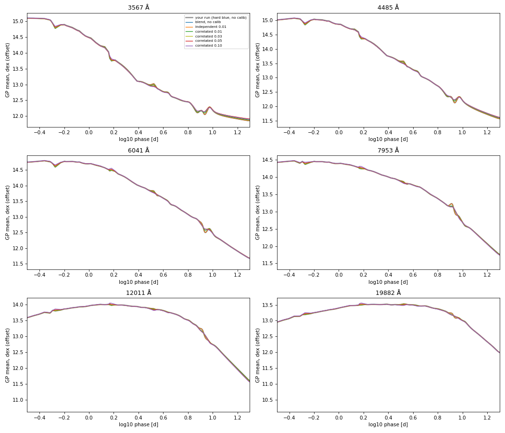
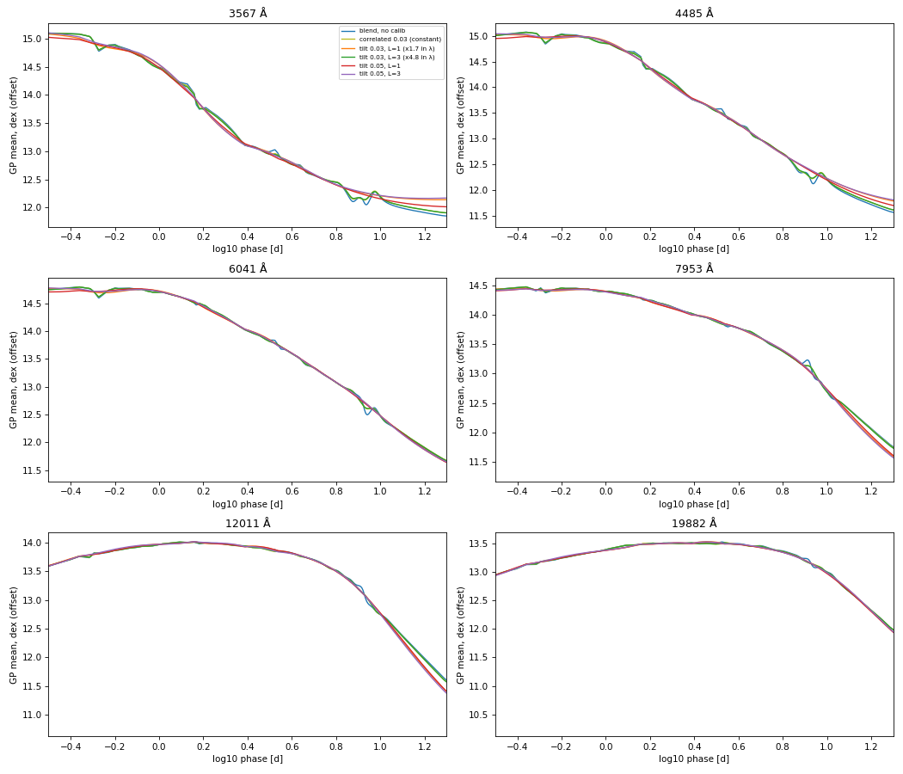
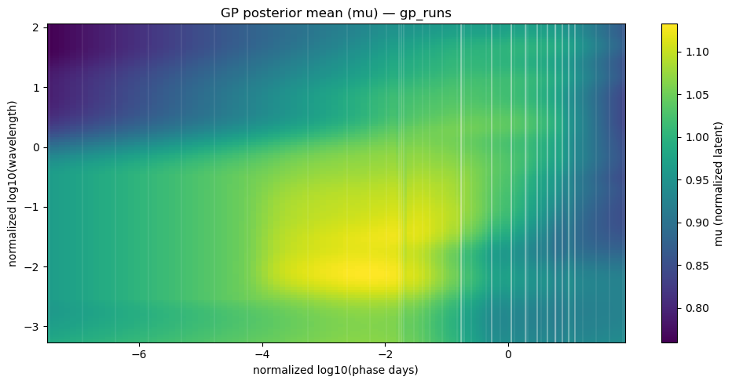

# Kilonova SED pipeline — user guide

This document is the full instruction manual for **kn-sed-pipeline**: a standalone log-space photometry and spectroscopy pipeline that builds a time-evolving spectral energy distribution (SED) from multi-band light curves and sparse spectra. The default worked example is **AT2017gfo**.

Read this guide when you need to run the pipeline end to end, prepare a new transient, interpret outputs, or change configuration. For a shorter first-pass overview, start with the repository [README](../README.md). For equations and scientific rationale, see the [Pipeline Writeup](PIPELINE_WRITEUP.md).

---

## 1. Prerequisites

### 1.1 Software

You need:

- **Python 3.10 or newer** (Python 3.12 is tested in development).
- A virtual environment is strongly recommended.
- All packages in [`requirements.txt`](../requirements.txt). The non-standard dependency that most often needs attention is **george** (Gaussian Process library). Also required: numpy, scipy, pandas, matplotlib, astropy, extinction, synphot, emcee, scikit-learn, and jupyter (for preparation notebooks).

Install with:

```bash
cd /path/to/kn-sed-pipeline
python -m venv .venv
source .venv/bin/activate
pip install -r requirements.txt
```

### 1.2 The `COCO_PATH` environment variable

Every notebook and script resolves paths relative to the repository root. That root is taken from the environment variable **`COCO_PATH`**, or, if unset, from the parent of the `Codes/` directory when `pipeline_config.py` is imported.

```bash
export COCO_PATH="/path/to/kn-sed-pipeline"
```

`COCO_PATH` must point at the folder that contains `Codes/`, `Inputs/`, and `Outputs/`. Trailing slashes are normalized by the configuration module.

### 1.3 Headless plotting

On servers without a display, set:

```bash
export MPLBACKEND=Agg
```

Production scripts already force the Agg backend where they create figures. Setting it in the shell avoids failures when you import plotting helpers from an interactive session.

### 1.4 Repository layout

| Path | Purpose |
|------|---------|
| `Codes/` | Preparation notebooks, production `.py` drivers, and `pipeline_config.py` |
| `Codes/helper_scripts/` | Shared libraries (light-curve fit, prescale, mangling, iterative Gaussian Process) |
| `Codes/helper_scripts/twodim_gp/` | Vendored two-dimensional Gaussian Process inference and plots |
| `Codes/helper_scripts/docs/` | Developer phase notes (prescale, iteration, data flow, QA) |
| `Codes/helper_scripts/tests/` | Unit tests |
| `Inputs/Photometry/` | Light-curve stages (`1_` raw AB mags + step-0 fluxes → `3_` extrapolated; neither is dust-corrected) |
| `Inputs/Spectroscopy/` | Original, clipped (0.2), with-errors (0.3) and prescaled (step 4) spectra plus list files |
| `Inputs/Filters/` | Filter throughput tables (`GeneralFilters/` and variants) |
| `Inputs/SNe_Info/` | Metadata table (`info.dat`): redshift, type, and the dust parameters used to deredden the final SED |
| `Inputs/Standards/` | Vega reference spectrum (`alpha_lyr_stis_006.fits`, CALSPEC): zero point for Vega magnitudes in step 0 and notebook 7.6 |
| `Inputs/2DIM_priors/` | Optional surface priors for the two-dimensional Gaussian Process |
| `Outputs/<SN>/` | All pipeline products for one supernova or kilonova name |
| `docs/` | This user guide, the scientific writeup, and PDF build scripts |

---

## 2. First complete run (AT2017gfo)

This section walks through a full production run on the shipped AT2017gfo inputs. Always start with step 0 (§2.3), which checks that the raw photometry fluxes are consistent with the AB magnitudes and filter curves. It then assumes notebooks 0.2, 0.3 and 2 have produced clipped spectra with uncertainties and an extrapolated light curve, or that you are willing to run those notebooks first.

### 2.1 Environment check

```bash
export COCO_PATH="/path/to/kn-sed-pipeline"
cd "$COCO_PATH/Codes"
source ../.venv/bin/activate   # if you use a venv
python -c "import pipeline_config as p; print(p.COCO_PATH); print(p.SNNAME_DEFAULT)"
```

You should see your repository path and `AT2017gfo`.

### 2.2 Optional reset

If a previous run left stale products:

```bash
python clear_sn_run.py --snname AT2017gfo --yes
```

This empties `Outputs/AT2017gfo/` but keeps the directory. Prescaled spectra under `Inputs/` are **not** deleted unless you also pass `--include-input-intermediates` (requires `--yes`). Use `--dry-run` to list targets without deleting.

### 2.3 Step 0: magnitudes to fluxes (always run first)

```bash
cd "$COCO_PATH/Codes"
python 0_Mag_to_Flux_KN.py --snname AT2017gfo --check
```

`--check` recomputes `Flux`/`Flux_err` in `Inputs/Photometry/1_LCs_flux_raw/AT2017gfo.dat` from `Mag`/`Mag_err` at each filter's pivot wavelength (§5.0) and prints a per-band table. It exits with status 0 if the file is consistent and 1 if any band is stale; it never writes.

If it fails, or you have new photometry, rebuild the raw file. **Rename the old file first** — step 0 refuses to replace an existing file unless you pass `--overwrite`:

```bash
mv ../Inputs/Photometry/1_LCs_flux_raw/AT2017gfo.dat ../Inputs/Photometry/1_LCs_flux_raw/AT2017gfo_old.dat
# either: build it from the compiled-photometry JSON (§3.1)
python 0_Mag_to_Flux_KN.py --snname AT2017gfo --from-json /path/to/KN_SED_DATA_dust_corrected.json
# or: keep the old rows and recompute only Flux/Flux_err
python 0_Mag_to_Flux_KN.py --snname AT2017gfo --redo-fluxes --input ../Inputs/Photometry/1_LCs_flux_raw/AT2017gfo_old.dat
```

**Whenever step 0 rewrites the raw file, every downstream product is stale.** Re-run notebook 2 (to regenerate `3_LCs_extrapolated/`) and then steps 3–6. Re-run step 0 whenever you add photometry or change a filter curve.

> **AT2017gfo note (October 2026).** The raw `Flux` column was regenerated with step 0 (issue #3). The previous version used a blue-shifted "effective wavelength" and was 0.07–0.6 mag too bright depending on band. The shipped `3_LCs_*` files and any existing `Outputs/` were built from the old fluxes, and were dust-corrected by the retired notebook 1 (issue #4); they must be regenerated (notebook 2, then steps 3–6) before results are used.

### 2.4 Preparation notebooks (if needed)

If `Inputs/Photometry/3_LCs_extrapolated/AT2017gfo.dat` (built from the current step-0 fluxes) and `Inputs/Spectroscopy/1.6_spec_lists_errors/AT2017gfo.list` already exist, you may skip to the scripts. Otherwise open Jupyter from `Codes/` and run:

1. `0.2_Reduce_spectra_KN.ipynb` (clip each spectrum; §4.1)
2. `0.3_Spectral_errors_KN.ipynb` (flux uncertainties; §4.2)
3. `2_LC_modelRising_KN_fullfit_log.ipynb`

`0.1_Smooth_spectra_KN.ipynb` is the old smoothing notebook; it is no longer part of the pipeline.

There is no dust-correction notebook: photometry and spectra are fit as observed, and step 6 removes the dust from the final SED (§3.4).

Confirm that `SN_EXPLOSION_MJD["AT2017gfo"]` in `pipeline_config.py` matches the explosion (merger) time used in notebook 2.

### 2.5 Production scripts

```bash
cd "$COCO_PATH/Codes"

python 3_LCfit_KN_log.py --snname AT2017gfo

python 4_Scale_spectra_KN.py --snname AT2017gfo --write-groups-only
# Open Outputs/AT2017gfo/AT2017gfo_spec_scale_groups.json and confirm
# XSHOOTER UVB/VIS/NIR groups and merge_order before continuing.
python 4_Scale_spectra_KN.py --snname AT2017gfo

python 5_Mangle_spectra_KN_log.py --snname AT2017gfo --save-epoch-plots

python 6_Iterative_GP_mangle_KN.py --snname AT2017gfo --max-iters 20 --verbose
```

**When the spectra change, run step 4 before step 3.** Step 3 evaluates the light-curve fit at every spectrum epoch and reads the epochs from step 4's list (`2_spec_lists_prescaled/<SN>.list`). After re-clipping in 0.2, re-running 0.3, or adding or removing spectra, the order is 4 → 3 → 5 → 6.

### 2.6 What each command reads and writes

| Step | Reads | Writes |
|------|-------|--------|
| 0 | `--from-json`: compiled-photometry JSON; `--redo-fluxes`/`--check`: `Inputs/Photometry/1_LCs_flux_raw/AT2017gfo.dat` (or `--input`); always `Inputs/Filters/<FilterSet>/<band>.dat` | `Inputs/Photometry/1_LCs_flux_raw/AT2017gfo.dat` (or `--output`; refuses to replace an existing file without `--overwrite`), `Outputs/AT2017gfo/AT2017gfo_step0_json_rows.csv` (JSON mode); nothing with `--check` |
| 3 | `Inputs/Photometry/3_LCs_extrapolated/AT2017gfo.dat`, `2_spec_lists_prescaled/AT2017gfo.list` (spectroscopy Modified Julian Dates, from step 4) | `Outputs/AT2017gfo/fitted_phot4mangling_AT2017gfo.dat`, `fitted_phot_logspace_AT2017gfo.dat`, optional `fittedGP_*.pdf` |
| 4 (groups only) | `1.6_spec_lists_errors/AT2017gfo.list` | `Outputs/AT2017gfo/AT2017gfo_spec_scale_groups.json` |
| 4 (scale) | Spectra with errors (`1.6_spec_errors/`) + groups JSON | `Inputs/Spectroscopy/2_spec_prescaled/AT2017gfo/`, `2_spec_lists_prescaled/AT2017gfo.list`, scale report and diagnostics |
| 5 | Prescaled list + spectra, `fitted_phot4mangling_*.dat`, filters, raw photometry for band Modified Julian Date windows | `Outputs/AT2017gfo/mangled_spectra/`, `AT2017gfo_band_mjd_ranges.json` (if missing), `figs/mangle_*` |
| 6 | Mangled spectra, both fitted photometry tables, prescaled list, groups JSON, `info.dat` (dust) | `Outputs/AT2017gfo/twodim_iter/` (iterations, metrics, final products, diagnostics), `FINAL_spectra_2dim/as_observed/`, `FINAL_spectra_2dim/dereddened/` |

### 2.7 Expected artifacts checklist

| Step | Key outputs to verify |
|------|------------------------|
| 0 | `python 0_Mag_to_Flux_KN.py --snname AT2017gfo --check` prints `OK` and exits 0 |
| 3 | `fitted_phot4mangling_AT2017gfo.dat` and `fitted_phot_logspace_AT2017gfo.dat` exist and are non-empty |
| 4 | Prescaled directory contains one file per spectrum in `1.6_spec_lists_errors`; groups JSON lists XSHOOTER triplets |
| 5 | `mangled_spectra/` has one mangled file per successfully constrained epoch; epoch PDFs under `figs/mangle_epoch/` |
| 6 | `twodim_iter/final/full_gp/` has extended spectra; `FINAL_spectra_2dim/as_observed/` and `dereddened/` hold the same file names, and `dereddened/dust_params.json` shows the expected $E(B-V)$, $R_V$ and law; `twodim_iter/diagnostics_summary/index.html` opens; `gp_vs_mangled` PDFs show full instrument wavelength spans |

Runtime for step 6 depends on iteration count and machine; a short debug run with `--max-iters 2` is useful before a full `--max-iters 20` production pass.

---

## 3. Input data reference

### 3.1 Photometry stages

| Stage folder | Written by | Role |
|--------------|------------|------|
| `Inputs/Photometry/1_LCs_flux_raw/` | Step 0 (from a compiled-photometry JSON, or `--redo-fluxes` on a user-written file) | Observed (not dust-corrected) AB magnitudes and their pivot-wavelength band fluxes; also used to auto-build `<SN>_band_mjd_ranges.json` in step 5 |
| `Inputs/Photometry/3_LCs_extrapolated/` | Notebook 2 | Input to step 3 light-curve Gaussian Process |
| `Inputs/Photometry/3_LCs_early_extrapolated/` | Notebook 2 (intermediate) | Early-only preview or intermediate products in some workflows |

Legacy checkouts may still have `4_LCs_late_extrapolated/`. The configuration module falls back to that path for the extrapolated stage if `3_LCs_extrapolated/` is missing, and emits a warning. Prefer migrating files to `3_LCs_extrapolated/`.

**Filename:** always `<SN>.dat` (example: `AT2017gfo.dat`).

**Extrapolated columns (typical):** `MJD`, `band`, `Flux`, `Flux_err`, `FilterSet`, `Instr`, `Phase`, `Log_Phase`, `Log_Flux`, `Log_Flux_err`.

**Raw columns (required):** `MJD`, `Mag`, `Mag_err`, `Flux`, `Flux_err`, `band`, `Instr`, `FilterSet` (comma-separated), plus an optional trailing **`MagSys`** (`AB` or `Vega`; missing column or blank = AB). `Mag` is the published magnitude in the filter system the measurement was reported in, in the system given by `MagSys`; `band` must match `Inputs/Filters/<FilterSet>/<band>.dat`. Step 0 always writes `Flux`/`Flux_err` and, from JSON, `MagSys`.

**Who reads which columns.** Notebook 2, step 5's band-MJD windows, and therefore steps 3–6 use only `MJD`, `band`, `Flux`, `Flux_err` (`FilterSet`, `Instr` are passed through; notebook 2 writes only these six columns plus its phase and log-flux columns to `3_LCs_extrapolated`); all read the file with column names, so the extra raw columns change nothing. Only QA code reads `Mag` (notebooks 7.5/7.6, `comparison_trapz_lc.py`, `plotting-final.ipynb`); 7.6 reports synthetic magnitudes in each row's own system (`mag_<x>_insys`), while the 7.5 notebooks and `plotting-final.ipynb` still plot `Mag` as AB, which is off by $m_{AB}-m_{\rm Vega}$ for Vega rows (about $-0.01$ mag for the current Sinistro $V$ points).

**Compiled-photometry JSON (input to `--from-json`).** A JSON list with one record per observation, as exported from the photometry compilation spreadsheet (`KN_SED_Data.json`, `KN_SED_DATA_dust_corrected.json`). Keys used:

| Key | Use |
|-----|-----|
| `MJD` | Copied to `MJD` (must be numeric) |
| `Telescope`, `Instrument`, `Filter` | Matched to a filter curve: `<Instrument>_<Filter>`, else `<Telescope>_<Filter>`; exact, then case-insensitive. `band` is the matched file name; `Instr` is `Instrument` (or `Telescope` if `Instrument` is `-`) |
| `Villar Mag`, `Villar Mag_err` | Copied to `Mag`, `Mag_err` exactly as given (override the keys with `--mag-key`, `--mag-err-key`) |
| `AB/VEGA/Etc` | Written to `MagSys`: `AB` kept; `Vega` **kept in Vega** (below); `-`/empty kept **as AB with a warning**; anything else dropped |
| `Used in Villar model?` | Only with `--villar-used-only`: keep rows marked `*` |
| `Repeated obs` | Only with `--drop-repeated`: drop rows marked `R` (repeated observation), keep everything else |
| `Refrence` | Copied to the row report |

Magnitudes must **not** be dust-corrected (step 6 removes the dust from the final SED), so any published dereddening has to be undone in the JSON before step 0; step 0 cannot tell from the JSON whether that was done. Rows are dropped when MJD, magnitude, or error is non-numeric, the magnitude is a limit (`>`/`<`), the system is neither AB nor Vega, or no filter curve matches (add the curve under `Inputs/Filters/GeneralFilters/` to keep them).

**Vega magnitudes.** A Vega magnitude is defined like an AB magnitude but relative to the spectrum of Vega (Vega = 0 mag in every band). Because both use the same photon-weighted band mean, each filter has an exact, SED-independent offset
$$m_{AB} = m_{\rm Vega} - 2.5\log_{10}\frac{\int f^{\rm Vega}_\lambda S\lambda\,d\lambda}{\int f^{AB}_\lambda S\lambda\,d\lambda},$$
computed from `Inputs/Standards/alpha_lyr_stis_006.fits` (override with `--vega-spectrum`). Step 0 keeps the published Vega magnitude in `Mag`, sets `MagSys = Vega`, and computes the flux from the Vega zero point, $\langle f_\lambda\rangle = 10^{-0.4\,m_{\rm Vega}}\langle f^{\rm Vega}_\lambda\rangle$ — the same flux the AB conversion would give. `--check` and `--redo-fluxes` use `MagSys` too. Typical offsets: about $-0.01$ in $V$, $-0.10$ in $B$, $+0.4$ in $i$, $+0.92$ in $J$, $+1.83$ in $K_s$. Notebook 7.6 uses the same offsets to give, for Vega rows, the synthetic magnitude in Vega (`mag_<x>_insys`).

**Repeated observations.** The compilation often lists the same measurement from several papers; Villar et al. mark the copies with `R` in `Repeated obs` and use one of them (often their own averaged value, `A`). `--drop-repeated` removes the `R` rows only, so rows Villar excluded for other reasons stay in; `--villar-used-only` applies Villar's full selection instead. Rows that repeat an MJD and band (the same epoch from several papers) are kept but flagged. A repeated CSV header record is skipped. Every decision is written to `Outputs/<SN>/<SN>_step0_json_rows.csv` (`status` = `kept` / `kept_assumed_AB` / `dropped`, plus `reason` and `MagSys`).

**Flux convention.** Every `Flux` in the pipeline is the photon-weighted band-mean $F_\lambda$ in erg s$^{-1}$ cm$^{-2}$ Å$^{-1}$,
$$\langle f_\lambda\rangle=\frac{\int f_\lambda S\lambda\,d\lambda}{\int S\lambda\,d\lambda}
= 3631\,\mathrm{Jy}\times10^{-0.4m_{AB}}\,\frac{c}{\lambda_{\rm piv}^2},\qquad
\lambda_{\rm piv}=\sqrt{\frac{\int S\lambda\,d\lambda}{\int S/\lambda\,d\lambda}},$$
where $S(\lambda)$ is the filter's photon-counting throughput. The second equality holds exactly for AB magnitudes, independent of the source SED, so step 0 converts at the **pivot** wavelength. This is the same quantity the mangling step fits (`band_flux_trapz`) and the standard (photon-counting) AB definition used for synthetic photometry. Errors propagate as $\sigma_F = F\cdot0.4\ln10\cdot\sigma_m$, which is adequate for S/N $\gtrsim$ 10. Log columns use $\log_{10}$ flux.

### 3.2 Spectroscopy stages

| Folder | Written by | Role |
|--------|------------|------|
| `Inputs/Spectroscopy/1_spec_original/<SN>/` | You | Spectra as delivered (observed or rest frame) |
| `Inputs/Spectroscopy/1_spec_lists_original/` | You | List files (`<SN>.list`) |
| `Inputs/Spectroscopy/1.5_spec_clipped/<SN>/` | Notebook 0.2 | Clipped spectra in the observed frame, plus `<SN>_clip_regions.json` (the regions, edges and low-S/N flags you chose) |
| `Inputs/Spectroscopy/1.5_spec_lists_clipped/` | Notebook 0.2 | List of clipped spectra |
| `Inputs/Spectroscopy/1.6_spec_errors/<SN>/` | Notebook 0.3 | Same pixels with flux uncertainties; **step 4 input** (`REDUCED_SPEC_SUBDIR`) |
| `Inputs/Spectroscopy/1.6_spec_lists_errors/` | Notebook 0.3 | List for step 4 (`REDUCED_SPEC_LIST_SUBDIR`) |
| `Inputs/Spectroscopy/2_spec_prescaled/<SN>/` | Step 4 | Flux-rescaled arms |
| `Inputs/Spectroscopy/2_spec_lists_prescaled/` | Step 4 | List used by steps 3, 5 and 6 (`USE_PRESCALED_SPECTRA=True`) |

`2_spec_smoothed/` and `2_spec_lists_smoothed/` hold the old smoothed spectra and are no longer read.

**List format:** three whitespace-separated fields per line — Modified Julian Date, phase (days), path to spectrum file. Paths may be absolute or relative to `COCO_PATH`; the prescale helpers rewrite stale roots that still contain older repository names when possible.

**Original spectrum files.** Two layouts are read:

- two columns: wavelength (Å), flux; no errors (for example LDSS3);
- four or more columns, ESO/ENGRAVE style: wavelength, flux, (unused), flux error (for example XSHOOTER).

A three-column file (wavelength, flux, error) is read **without its errors**; reformat it before notebook 0.2.

**Frame.** Every spectrum must reach the production steps in the observed frame. Files that are already de-redshifted are listed in `REST_FRAME_FILES` in `Codes/helper_scripts/spec_reduce.py` (matched by a substring of the file name, per object); notebook 0.2 multiplies their wavelengths by $(1+z)$ when it loads them. Only the wavelength is shifted: the constant $1/(1+z)$ flux factor is absorbed by the step-4 and step-5 scaling. For AT2017gfo the LDSS3 spectra are rest frame and are listed.

**Reduced spectrum files** (0.2, 0.3 and step 4 output) have four columns:

```text
#wls	flux	flux_err	weight
4100.5563	1.154365e-15	5.256699e-17	1
```

`weight` is 1 for data and 0 for pixels clipped in 0.2. Clipped interior pixels are bridged by a straight line between the median fluxes just outside the region, so the file has no gaps; every later step ignores them. `flux_err` is `nan` after 0.2 for files without errors and is filled in by 0.3.

**Naming conventions that matter for grouping:**

- XSHOOTER arms: filenames containing `UVB_`, `VIS_`, `NIR_` (or similar) near the same Modified Julian Date are grouped together.
- Single-instrument spectra (for example Magellan/LDSS3) remain ungrouped individuals unless you edit the groups JSON.

**Adding spectra.** Put the files in `1_spec_original/<SN>/` and add their lines to the original list; add rest-frame files to `REST_FRAME_FILES`; add a section for each new spectrum to notebooks 0.2 and 0.3 (copy an existing section and change `i`); then run step 4 (with `--write-groups-only` first if new arms were taken together), step 3, step 5 and step 6.

### 3.3 Filters

Throughput tables live under `Inputs/Filters/GeneralFilters/` for the default AT2017gfo path: two columns, wavelength in Å and **photon-counting** throughput (filter $\times$ detector QE $\times$ optics; the overall normalization does not matter). The mangling code and step 0 resolve each band name to a transmission file. Use the curve of the system the magnitudes are **reported** in: the instrument's natural system for natural-system photometry, or the standard system's curve if a paper transformed its photometry to a standard system. If you add or replace a filter curve, re-run step 0, because the pivot wavelength changes. Events that need Carnegie Supernova Project (CSP) natural-system filters can be listed in `CSP_SNE` inside `pipeline_config.py` so that CSP-specific filter directories are preferred.

### 3.4 Supernova info table

`Inputs/SNe_Info/info.dat` holds one space-separated row per object: `Name z RA Dec FullType Type Rich_Type EBV_MW EBV_host RV_MW RV_host`. Add one row per new object following the header comments in that file.

The four dust columns are **required**; step 6 checks them before fitting and stops with an error naming any that is missing or non-numeric. They are used only after the fit, to deredden the final SED wavelength by wavelength:

$$F_{\rm dered}(\lambda)=F_{\rm obs}(\lambda)\,10^{0.4\,[A_{\rm MW}(\lambda)+A_{\rm host}(\lambda/(1+z))]},\qquad A(\lambda)=\mathrm{law}(\lambda;\,R_V E(B-V),\,R_V)$$

Galactic dust is evaluated at the observed wavelength and host dust at the rest-frame wavelength, with the law from `DUST_LAW` (§7.4). `RV_MW` is normally 3.1. The shipped `RV_host` values follow the old notebook-1 table by type (Ic and Ic-BL 4.3, Ib 2.6, IIb 1.1, II, IIn and KN 3.1). Flux errors are scaled by the same factor; $E(B-V)$ and $R_V$ uncertainties are not propagated. Because the fit does not depend on these values, changing them only requires regenerating `FINAL_spectra_2dim/dereddened/` (re-run step 6, or call `dust.deredden_final_spectra` on `as_observed/`).

### 3.5 Scale groups JSON

Step 4 writes `Outputs/<SN>/<SN>_spec_scale_groups.json`. A minimal structure looks like:

```json
{
  "default_output_mode": "scale_only",
  "groups": [
    {
      "id": "group_suggested_000",
      "members": [
        "NIR_AT2017gfo_..._MJD-57983.969001_....dat",
        "UVB_AT2017gfo_..._MJD-57983.969002_....dat",
        "VIS_AT2017gfo_..._MJD-57983.969003_....dat"
      ],
      "merge_order": ["uvb", "vis", "nir"],
      "output_mode": "scale_only",
      "reason": "same_time_cluster"
    }
  ],
  "ungrouped": [
    "57983.01825_LDSS3_Magellan.dat"
  ]
}
```

- **`members`:** basenames of spectrum files that share a flux scale.
- **`merge_order`:** arm order for bridging and optional merging (`uvb`, `vis`, `nir`).
- **`output_mode`:** `scale_only` keeps separate files (default); `merge_join` writes one stitched spectrum per group.
- **`ungrouped`:** spectra scaled only to themselves (factor 1.0) and mangled individually.

Edit this file carefully after `--write-groups-only`. Incorrect groups produce seam jumps and poor bundle mangling.

---

## 4. Notebooks — guidance

Each notebook should call into `pipeline_config` (or `bootstrap_runtime`) rather than hard-coding absolute paths. Set `snname` to your object and ensure `COCO_PATH` is exported before launching Jupyter.

### 4.1 `0.2_Reduce_spectra_KN.ipynb` (clipping)

**Purpose.** Remove bad pixels and noisy ends from each spectrum, one spectrum at a time, without smoothing. Helpers: [`spec_reduce.py`](../Codes/helper_scripts/spec_reduce.py).

**Per-spectrum section.** Each spectrum has its own section with two cells.

1. **Proposal cell.** Loads the spectrum (shifting rest-frame files, §3.2), runs the finders with `params` (`DEFAULTS`, or `SN_LOW` for faint spectra), plots the raw spectrum, the proposals and the S/N, and prints the proposals as numbers:

   ```text
   telluric = [(6860, 6890), (7590, 7700), (9300, 9650)]
   edges = (6450, 9999)
   low S/N (flag only, 0): []
   spikes: 2 regions covering 9 A, width median 4.7 A, max 5.2 A
     widest: [(6449.9, 6454), (9994.5, 9999.7)]
   ```

2. **Clip cell.** What actually gets clipped:

   ```python
   spikes = proposed["spike"]                        # automatic
   # spikes = sr.remove_between(spikes, 5000, 6000)  # drop spikes in a range
   telluric = [(6860, 6890), (7590, 7700), (9300, 9650)]   # edit the numbers
   manual = []                                       # extra regions to clip
   edges = (6480, 9900)                              # blue and red cut
   regions = spikes + telluric                       # low S/N is flag-only
   ```

   Change a telluric number to shrink or widen a band, delete a tuple to keep that band, add tuples to `manual` for anything else. The plot writes each telluric and manual range above it, and `sr.print_clip(...)` prints the final list. Spikes stay automatic because XSHOOTER VIS/NIR spectra have 75–390 of them.

3. **Save cell.** `sr.save_clipped(...)` writes the clipped file, updates the clipped list and records your choices in `<SN>_clip_regions.json`. `sr.load_choices(SN, fname)` reads them back.

**What the finders propose.**

| Kind | Rule | Clipped by default? |
|------|------|---------------------|
| Spikes | Pixels more than `spike_nsigma` (5) local noise from a 50 Å running median, grown by 2 Å | Yes |
| Telluric | Fixed bands (O$_2$ B and A, H$_2$O at 9300–9650, 11100–11500, 13300–14500, 17900–19600 Å) inside the spectrum | Yes (edit the numbers) |
| Edges | Where S/N first and last stays above `snr_min` for 100 Å | Yes (outside `edges` is removed) |
| Low S/N | Stretches $\geq$ 20 Å below `snr_min` | **No — flag only**, drawn hatched. Add `+ proposed["low_snr"]` to `regions` to clip them |

**Instrument notes (X-shooter).** Treat about 5450–5900 Å as unusable in both arms: the UVB/VIS dichroic split drives the UVB flux toward zero near 5680 Å and the VIS blue end is very noisy. A UVB red edge near 5450–5500 Å and a VIS blue edge near 5550–5600 Å remove it. Below about 3650 Å the UVB flux calibration is uncertain (low throughput, residuals near the standard star's Balmer jump at 3646 Å); decide per spectrum whether to keep it, since it is the only spectral coverage of the *u* band.

**Common failures.** Editing the notebook while it is open in an editor that later saves an older copy (reload it from disk); forgetting to rerun the save cell after changing regions.

### 4.2 `0.3_Spectral_errors_KN.ipynb` (uncertainties)

**Purpose.** Give every pixel a flux uncertainty. The flux is **not** smoothed or resampled: the output has exactly the pixels of the 0.2 output. Helpers: [`spec_errors.py`](../Codes/helper_scripts/spec_errors.py).

**Structure.** An auto-run cell processes every spectrum with `DEFAULTS` (spectra you have customised are skipped unless `OVERWRITE_CUSTOMISED = True`), followed by one section per spectrum for overrides.

| Setting | Default | Meaning |
|---------|---------|---------|
| `err_mode` | `"trust"` | Spectra **with** errors: `"trust"` keeps them; `"rescale"` scales them to the noise estimate; `"estimate"` replaces them. Spectra without errors always use the estimate |
| `rescale_shape` | `"constant"` | For `"rescale"`: one factor (`"constant"`) or a factor linear in wavelength (`"linear"`) |
| `est_vexp_smooth` | `0.002` | Noise estimate (kaepora `genivar`): width of the smoothing whose residuals measure the noise ($\sigma = v_{\rm exp}\lambda$) |
| `est_vexp_resid` | `0.015` | Width of the smoothing applied to the absolute residuals |
| `nsig` | `5` | Smoothing kernels truncated at $\pm$`nsig` $\sigma$ |

The noise estimate converts the smoothed mean |residual| to a standard deviation with a factor computed per spectrum from its pixel size and the smoothing width (about 1.31 for LDSS3 and 1.26 for XSHOOTER), so nothing depends on the instrument name. Low-S/N regions are re-flagged on the plots.

**Outputs.** `1.6_spec_errors/<SN>/` and `1.6_spec_lists_errors/<SN>.list`, the input to step 4.

### 4.3 `2_LC_modelRising_KN_fullfit_log.ipynb`

**Prerequisite.** Step 0 (`0_Mag_to_Flux_KN.py --check`) passes, so the raw `Flux` column is current.

**Purpose.** Model the early rising light curve (Bazin and related functional forms), optionally force zero flux at explosion, extrapolate late times where needed, and commit the explosion Modified Julian Date used as phase zero downstream.

**Typical cell order.** Load the raw (not dust-corrected) photometry from `1_LCs_flux_raw/` → preview rising fits per band → commit extrapolation → write `3_LCs_extrapolated/<SN>.dat` → update or confirm `SN_EXPLOSION_MJD` in configuration.

**Outputs.** Extrapolated light curve under `Inputs/Photometry/3_LCs_extrapolated/`; possible intermediate early-extrapolation products.

**Common failures.** Explosion time inconsistent with configuration; excluding too many bands so some filters never get a rising model.

### 4.4 `LCfit_publication_plots.ipynb` (optional)

**Purpose.** Publication-quality light-curve figures after step 3 has written the Gaussian Process fit products.

**When to run.** After `3_LCfit_KN_log.py` succeeds.

### 4.5 Downstream QA notebooks (`7.5_*.ipynb`, `7.6_synthetic_photometry_final_gp.ipynb`, `bolometric_luminosity.ipynb`, `plotting-final.ipynb`)

**Purpose.** Compare synthetic photometry from final spectra to the light-curve fit; overlay spectra; construct bolometric luminosity; assemble final figures. `7.6_synthetic_photometry_final_gp.ipynb` writes synthetic magnitudes (AB, plus `mag_<x>_insys` in each input row's `MagSys`) through every observed filter, both on the GP epochs and at each input-photometry row, for chi-squared comparisons against the input data: `mag_AB_obs` from `FINAL_spectra_2dim/as_observed`, `mag_AB_dustcorr` from `FINAL_spectra_2dim/dereddened`, and `A_ext_band` = their difference, the SED-weighted band extinction at each epoch. Without a `dereddened/` folder it writes `mag_AB_obs` only, with a warning. Use its default `SYNTH_METHOD = "true_ab"`, which matches the step-0 convention.

**Which SED.** `bolometric_luminosity.ipynb` reads `FINAL_spectra_2dim/dereddened` (physical luminosity). The 7.5 notebooks and `plotting-final.ipynb` read `as_observed`, which is what the photometry they overlay measures; set `FINAL_VARIANT = pconf.FINAL_SPECTRA_VARIANT_DEREDDENED` in their config cell to plot the dereddened SED instead.

**Configuration.** Keep `USE_ITER_GP_MANGLE_FINAL = True` (default) so path helpers resolve `twodim_iter/final/` and the QA export under `FINAL_spectra_2dim/`. Re-run the configuration and data-directory cells after changing that flag.

**Prerequisites.** A finished step 6 run with `final/full_gp/` populated (and QA export enabled if you rely on `_FINAL_spec` naming).

**Common failures.** Pointing at empty legacy directories because the iteration flag is off; looking for calendar Modified Julian Date stems when files are keyed by log-phase stems from the Gaussian Process grid.

---

## 5. Script drivers

All drivers live in `Codes/` and accept `--snname` and usually `--coco-path`. Defaults come from `pipeline_config.py`.

### 5.0 `0_Mag_to_Flux_KN.py`

**Science role.** Creates or updates `Inputs/Photometry/1_LCs_flux_raw/<SN>.dat`, converting AB magnitudes into the band-mean $F_\lambda$ used everywhere downstream (§3.1). Exactly one mode is required:

| Mode | What it does |
|------|--------------|
| `--from-json PATH` | Builds the raw file from a compiled-photometry JSON (§3.1): filter matching, row selection, flux conversion, row report |
| `--redo-fluxes` | Reads an existing raw-format file (default: the raw file; or `--input`) and recomputes only `Flux`/`Flux_err`; all other columns unchanged |
| `--check` | Verifies an existing raw-format file; exit 1 if any band's `Flux` is stale; never writes |

The conversion is $F = 3631\,\mathrm{Jy}\times 10^{-0.4\,\mathrm{Mag}}\, c/\lambda_{\rm piv}^2$, with $\lambda_{\rm piv}$ computed from `Inputs/Filters/<FilterSet>/<band>.dat`, and $\sigma_F = F\cdot 0.4\ln 10\cdot\sigma_{\rm Mag}$. With `--redo-fluxes`, every other column is left unchanged and rows with an empty `Mag` keep their existing `Flux`.

**Flags.**

| Flag | Default | Meaning |
|------|---------|---------|
| `--snname` | `SNNAME_DEFAULT` | Object name (`<SN>.dat`) |
| `--coco-path` | `COCO_PATH` | Repository root |
| `--input` | raw file | Raw-format file to read for `--redo-fluxes` / `--check` |
| `--output` | raw file | Where to write (`--from-json`, `--redo-fluxes`) |
| `--overwrite` | off | Allow replacing an existing output file. **Rename the old file first** |
| `--filter-set` | `GeneralFilters` | Filter folder under `Inputs/Filters/` for `--from-json` |
| `--villar-used-only` | off | `--from-json`: keep only rows marked `*` in `Used in Villar model?` |
| `--drop-repeated` | off | `--from-json`: drop rows marked `R` in `Repeated obs`; keep everything else |
| `--vega-spectrum` | `Inputs/Standards/alpha_lyr_stis_006.fits` | Vega spectrum giving the zero point for `MagSys = Vega` rows (all modes) |
| `--mag-key`, `--mag-err-key` | `Villar Mag`, `Villar Mag_err` | `--from-json`: JSON keys holding the AB magnitude and its error |
| `--report` | `Outputs/<SN>/<SN>_step0_json_rows.csv` | `--from-json`: per-row report path |
| `--rtol` | `1e-6` | Relative tolerance for `--check` |

**Output.** `--from-json` prints how many records were kept/dropped (with reasons), the rows kept with warnings (assumed AB, Vega magnitudes, case-insensitive filter match), a warning if epochs are repeated, and the pivot wavelength and row count per band; it writes the raw file and the row report. `--redo-fluxes` / `--check` print a per-band table (pivot wavelength, number of rows, median `-2.5 log10(Flux_old/Flux_new)`, maximum relative change) followed by the path written or `OK`/`FAIL`.

> **Back up before writing.** `--from-json` and `--redo-fluxes` write `Inputs/Photometry/1_LCs_flux_raw/<SN>.dat` by default. If that file already exists the script **refuses to run** unless you pass `--overwrite`. **Rename the old file first** (e.g. `mv AT2017gfo.dat AT2017gfo_old.dat`) so nothing is lost, or write elsewhere with `--output`.

```bash
python 0_Mag_to_Flux_KN.py --snname AT2017gfo --from-json /path/to/KN_SED_DATA_dust_corrected.json
python 0_Mag_to_Flux_KN.py --snname AT2017gfo --redo-fluxes --input old_AT2017gfo.dat
python 0_Mag_to_Flux_KN.py --snname AT2017gfo --check
```

**Common failures.** Exit status 2 with "Refusing to overwrite" (the output exists: rename it or pass `--overwrite`); many rows dropped with "no filter curve" (add the curve or check the JSON `Instrument`/`Telescope`/`Filter` spelling against the file names); `FileNotFoundError` for a band in `--redo-fluxes`/`--check` (the `band` value does not match a filter file name); `ValueError` for non-AB `MagSys` values (only AB is supported).

### 5.1 `3_LCfit_KN_log.py`

**Science role.** For each photometric band, fit a one-dimensional Gaussian Process to $\log_{10}$ flux versus time (or log phase). Evaluate the posterior at every spectroscopy Modified Julian Date (for mangling constraints) and on a dense log-phase grid (for the two-dimensional Gaussian Process training table).

**Implementation.** [`helper_scripts/lc_gp_fit.py`](../Codes/helper_scripts/lc_gp_fit.py) with kernels from [`lc_gp_kernels.py`](../Codes/helper_scripts/lc_gp_kernels.py).

**Inputs.** Extrapolated light curve; step 4's prescaled list for the spectrum epochs (so run step 4 first when the spectra change); optional explosion anchor.

**Outputs.** `fitted_phot4mangling_<SN>.dat`, `fitted_phot_logspace_<SN>.dat`, optional summary PDFs.

| Flag | Default | Effect |
|------|---------|--------|
| `--snname` | `SNNAME_DEFAULT` | Target object |
| `--coco-path` | `COCO_PATH` | Repository root |
| `--kernel-settings` | None | Per-band kernel JSON overrides |
| `--save-general-plots` / `--no-save-general-plots` | on | Summary `fittedGP_*.pdf` |
| `--save-per-filter-plots` | off | One PDF per filter under `lc_gp_per_filter/` |
| `--anchor-t0-in-lc-gp` | config | Include explosion-time anchor in training |
| `--append-t0-row` | off | Extra row in the logspace photometry file |
| `--exclude-filt` | None | Override band exclusion list |

**Worked examples.**

```bash
# Standard production
python 3_LCfit_KN_log.py --snname AT2017gfo

# Per-filter diagnostic PDFs
python 3_LCfit_KN_log.py --snname AT2017gfo --save-per-filter-plots
```

### 5.2 `4_Scale_spectra_KN.py`

**Science role.** Multi-arm spectrographs (especially XSHOOTER) deliver separate UVB, VIS, and NIR files whose absolute flux calibrations may disagree in overlap regions. This step estimates multiplicative scale factors so arms join smoothly before mangling.

**Implementation.** [`helper_scripts/spectra_pre_scale.py`](../Codes/helper_scripts/spectra_pre_scale.py).

**Inputs.** Spectra with errors and their list (`1.6_spec_errors/`, `1.6_spec_lists_errors/`); optional existing groups JSON.

**Reduced spectra.** The overlap fit between arms uses inverse-variance bins `SPEC_SCALE_OVERLAP_BIN_A` (30 Å) wide in both arms: fitting raw noisy pixels biased the scale low (regression dilution). Seam windows and S/N use only `weight = 1` pixels, and bridge points written by `merge_join` get `weight = 0`. A group member missing from the list (for example a spectrum clipped away entirely) is skipped with a warning.

**Outputs.** Prescaled spectra and list; groups JSON; scale report; optional HTML diagnostics under `spec_scale_diagnostics/`.

| Flag | Effect |
|------|--------|
| `--write-groups-only` | Write or refresh the groups JSON template; do not scale |
| `--groups-json` | Override groups path |
| `--output-mode` | `scale_only` or `merge_join` |
| `--chain-mode` | Sequential arm bridging along `merge_order` |
| `--gap-max-a` | Maximum gap (angstroms) for gap-seam scaling |
| `--write-diagnostics` | Seam QA under `spec_scale_diagnostics/` |
| `--same-time-minutes` | Clustering window for suggested groups |
| `--verbose` | Extra logging |

**Worked examples.**

```bash
# Always do this two-step dance for a new object
python 4_Scale_spectra_KN.py --snname AT2017gfo --write-groups-only
# edit Outputs/AT2017gfo/AT2017gfo_spec_scale_groups.json
python 4_Scale_spectra_KN.py --snname AT2017gfo --write-diagnostics
```

### 5.3 `5_Mangle_spectra_KN_log.py`

**Science role.** At each spectroscopy epoch, compare synthetic photometry of the (prescaled) spectrum to the step-3 light-curve fit in every overlapping band. Fit a smooth mask $m(\lambda)$ in log flux so that after mangling, band fluxes match the light curve. Bundle-aware mode fits one shared mask per scale group using stitched synthetic photometry across arms.

**Implementation.** [`helper_scripts/mangle_spectra_log.py`](../Codes/helper_scripts/mangle_spectra_log.py).

**Inputs.** Prescaled list (default), `fitted_phot4mangling_*.dat`, filters, groups JSON, raw photometry for band Modified Julian Date ranges.

**Outputs.** `mangled_spectra/`; auto-written `*_band_mjd_ranges.json` when missing; `figs/mangle_nb5/` and optional `figs/mangle_epoch/`.

| Flag | Effect |
|------|--------|
| `--bundle-aware` / `--no-bundle-aware` | Shared mask per scale group |
| `--save-diagnostics` | HTML and PDF under `figs/mangle_nb5/` |
| `--save-epoch-plots` | Per-epoch PDFs under `figs/mangle_epoch/` |
| `--run-both-for-diag` | Per-arm and bundle compare (diagnostics only) |
| `--mangle-kernel-mode` | `fixed_5` (PyCoCo parity, default) or `kernel_divide_scaled` |
| `--kernel-divide` | Numerator when mode is `kernel_divide_scaled` (default 800) |
| `--groups-json` | Override groups path |
| `--verbose` | Extra logging |

**Worked examples.**

```bash
# Production with epoch plots
python 5_Mangle_spectra_KN_log.py --snname AT2017gfo --save-epoch-plots

# Compare kernel modes for diagnostics
python 5_Mangle_spectra_KN_log.py --snname AT2017gfo --mangle-kernel-mode fixed_5
python 5_Mangle_spectra_KN_log.py --snname AT2017gfo --mangle-kernel-mode kernel_divide_scaled --kernel-divide 800
```

**Synthetic photometry.** The band flux is $\bar F=\sum a_i F_i/\sum a_i$ with $a_i=T(\lambda_i)\lambda_i\Delta\lambda_i$, and its error is $\sqrt{\sum (a_i\sigma_i)^2}/\sum a_i$, which is correct for any pixel size. A filter whose band (weighted by $a_i$) is more than `MANGLE_MAX_CLIPPED_FRAC` (50%) clipped gives no constraint; otherwise its error is divided by the unclipped fraction.

**Binning onto the GP grid.** After the mask is applied, each mangled spectrum is inverse-variance binned **in linear flux** onto the two-dimensional GP's log-wavelength grid (steps of `ITER_GP_GRID_DELTA` = 30 Å), excluding clipped pixels, and only then converted to log flux. Bins with S/N below `MANGLE_BIN_MIN_SNR` (3) are dropped. Taking the log of single noisy pixels would bias the flux and fail on negative pixels, and the exact GP cannot take every raw pixel (about 579,000 for AT2017gfo). All spectra are binned onto one grid built from all of them, and the files carry a `gp_grid_binned` header tag.

If `Outputs/<SN>/<SN>_band_mjd_ranges.json` is missing, step 5 builds it from `Inputs/Photometry/1_LCs_flux_raw/<SN>.dat`. You do not need legacy repository-root Modified Julian Date CSV files.

### 5.4 `6_Iterative_GP_mangle_KN.py`

**Science role.** Outer loop: fit a two-dimensional Gaussian Process on mangled spectra plus photometry; extract the surface at observed spectroscopy epochs; remove the current mangling mask (demangle); build a new mask from demangled Gaussian Process spectra versus the light-curve fit (often on the full Gaussian Process wavelength grid); apply the new mask to **prescaled originals**; repeat until photometry closure or the iteration cap.

**Implementation.** [`helper_scripts/iterative_gp_mangle.py`](../Codes/helper_scripts/iterative_gp_mangle.py), with Gaussian Process fitting via [`iter_gp_grid.py`](../Codes/helper_scripts/iter_gp_grid.py) and the vendored [`twodim_gp/`](../Codes/helper_scripts/twodim_gp/) package.

**Inputs.** Step 5 mangled spectra (seed for `iter_00`), both fitted photometry tables, prescaled list and files, groups JSON, filters.

**Outputs.** `Outputs/<SN>/twodim_iter/` including per-iteration mangled spectra, predictions, figures, metrics, and `final/`. At the end it copies the final SED to `FINAL_spectra_2dim/as_observed/` and writes the dereddened SED to `FINAL_spectra_2dim/dereddened/` (§3.4). Iteration folders and `predictions.npz` stay as observed.

| Flag | Effect |
|------|--------|
| `--max-iters` | Cap (config default 20) |
| `--phot-convergence-frac` | Stop when max relative photometry error is below this |
| `--bundle-aware` | Bundle remangle |
| `--seed-from-nb5` | Copy step-5 mangled spectra into `iter_00` |
| `--warm-start` | Warm-start Gaussian Process hyperparameters from the previous iteration |
| `--save-diagnostics` | Write figure suites and metrics |
| `--t0-fix` | Override explosion Modified Julian Date |
| `--verbose` | Extra logging |

**Worked examples.**

```bash
# Short debug
python 6_Iterative_GP_mangle_KN.py --snname AT2017gfo --max-iters 2 --verbose

# Production
python 6_Iterative_GP_mangle_KN.py --snname AT2017gfo --max-iters 20 --verbose
```

Each re-mangle bins onto the same grid as step 5, and the grid preparation copies binned values onto the grid nodes without interpolating, so a clipped gap stays empty instead of being filled. The photometry-closure check compares only bands observed around each epoch (inside that band's MJD range).

Default `ITER_MANGLE_USE_GP_WAVELENGTH_GRID=True` means remangle constraints are built from a demangled Gaussian Process SED sampled across the **full training wavelength range**, not only each arm’s native span. The new mask is still applied to the original prescaled wavelength grids.

### 5.5 `clear_sn_run.py`

**Role.** Delete or list output products for one supernova so you can re-run cleanly.

| Flag | Effect |
|------|--------|
| `--snname` | Required object name |
| `--dry-run` | Print paths only |
| (default) | Empty `Outputs/<SN>/` but keep the directory |
| `--include-input-intermediates` | Also delete prescaled spectroscopy directory and list (**requires `--yes`**) |
| `--yes` | Confirm destructive actions |

**Warning.** `--include-input-intermediates` removes `Inputs/Spectroscopy/2_spec_prescaled/<SN>/` and the matching list. Re-run step 4 afterward.

---

## 6. Iteration plot layout and quality assurance

Per-iteration figures land under `Outputs/<SN>/twodim_iter/iter_KK/figs/`.

| Subfolder | Content |
|-----------|---------|
| `gp_surface/` | Heatmaps of the two-dimensional Gaussian Process mean and uncertainty, wavelength and phase slices, training residuals and coverage |
| `gp_vs_mangled/` | Input mangled spectrum versus Gaussian Process extract. For individuals, the x-axis is the **full prescaled wavelength span**; the Gaussian Process curve is interpolated onto that grid. Groups are stitched before plotting |
| `mangle_delta/` | Difference between the new mangling and the input mangling for that iteration |
| `residuals/` | Gaussian Process minus mangled, compared to uncertainties, on the full mangled wavelength span |
| `phot_lc/` | Posterior light curves and mangled synthetic photometry versus `gp_fit` targets |
| `debug/bundle_scaling/` | Optional bundle-pair scaler plots when `PLOT_BUNDLE_SCALING_QA=True` |

Run-level metrics live in `twodim_iter/metrics/` (for example `chi2_vs_iter.png`, `lengthscales_vs_iter.png`). Gaussian Process inference caches (not plots) live under `iter_KK/gp_runs/inference/`. Open `twodim_iter/diagnostics_summary/index.html` for a clickable overview.

Detailed physical data flow for each remangle iteration is documented in [`Codes/helper_scripts/docs/ITERATIVE_MANGLING_DATA_FLOW.md`](../Codes/helper_scripts/docs/ITERATIVE_MANGLING_DATA_FLOW.md).

---

## 7. `pipeline_config.py` reference

Edit [`Codes/pipeline_config.py`](../Codes/pipeline_config.py) or override via command-line flags where supported. Change a knob only when you understand which stage reads it.

### 7.1 Object identity and paths

| Constant | Default | When to change |
|----------|---------|----------------|
| `SNNAME_DEFAULT` | `AT2017gfo` | Default `--snname` for scripts |
| `SN_EXPLOSION_MJD` | per-object dict | Phase zero / $t_0$; must match notebook 2 |
| `SN_REDSHIFT` | per-object dict | Distance and rest-frame conversions where used |
| `CSP_SNE` | `()` | Add names that need CSP filter routing |
| `COCO_PATH` | env or auto | Override repository root |

### 7.2 Prescale (step 4)

| Constant | Default | When to change |
|----------|---------|----------------|
| `SPEC_SCALE_OUTPUT_MODE` | `scale_only` | Use `merge_join` only if you want one file per group |
| `SPEC_SCALE_CHAIN_MODE` | `False` | `True` for sequential bridging along `merge_order` |
| `SPEC_SCALE_STAR_BRIDGE_FALLBACK` | `True` | One-hop bridge when the arm is not adjacent to the anchor |
| `SPEC_SCALE_GAP_MAX_A` | `400` | Maximum gap (angstroms) allowed for gap-seam scaling |
| `SPEC_SCALE_SAME_TIME_MINUTES` | `5` | Clustering window for suggested groups |
| `SPEC_SCALE_OVERLAP_BIN_A` | `30.0` | Bin width (Å) for the arm-overlap fit |
| `REDUCED_SPEC_SUBDIR`, `REDUCED_SPEC_LIST_SUBDIR` | `1.6_spec_errors`, `1.6_spec_lists_errors` | Step-4 input folders (notebook 0.3 output) |

### 7.3 Mangling (step 5 and remangle in step 6)

| Constant | Default | When to change |
|----------|---------|----------------|
| `USE_PRESCALED_SPECTRA` | `True` | Leave on for production; off only for legacy smoothed-only tests |
| `MANGLE_BUNDLE_AWARE` | `True` | Shared mask per group (recommended for XSHOOTER) |
| `MANGLE_GP_KERNEL_MODE` | `fixed_5` | PyCoCo parity; switch to `kernel_divide_scaled` only for experiments |
| `MANGLE_GP_KERNEL_FIXED` | `5.0` | Fixed Matérn 3/2 length in normalized log-wavelength when mode is `fixed_5` |
| `MANGLE_KERNEL_DIVIDE` | `800` | Used only in `kernel_divide_scaled` mode |
| `MANGLE_BUNDLE_STITCH_SYNPHOT` | `True` | Integrate filters on stitched multi-arm spectra |
| `MANGLE_RUN_BOTH_FOR_DIAG` | `False` | Turn on to compare per-arm versus bundle once |
| `MANGLE_MAX_CLIPPED_FRAC` | `0.5` | Skip a filter whose band is more than this fraction clipped |
| `MANGLE_BIN_MIN_SNR` | `3.0` | Drop GP-grid bins of a mangled spectrum below this S/N |

### 7.4 Iterative two-dimensional Gaussian Process (step 6)

| Constant | Default | When to change |
|----------|---------|----------------|
| `ITER_GP_MANGLE_MAX_ITERS` | `20` | Lower for debugging; raise only if convergence is slow but improving |
| `PHOT_CONVERGENCE_FRAC` | `0.05` | Primary stop: max relative synthetic photometry error |
| `MASK_CONVERGENCE_EPS` | `1e-4` | Secondary logging on mask change |
| `ITER_MANGLE_USE_GP_WAVELENGTH_GRID` | `True` | Full-wavelength remangle constraints (recommended) |
| `ITER_GP_SEED_FROM_NB5` | `True` | Seed `iter_00` from step 5 mangled spectra |
| `ITER_GP_WARM_START` | `True` | Reuse hyperparameters between iterations |
| `ITER_GP_EXPORT_FULL_GP` | `True` | Write extended spectra under `full_gp/` |
| `ITER_EXPORT_FINAL_SPEC_FOR_QA` | `True` | Copy QA-named spectra to `FINAL_spectra_2dim/as_observed/` for notebooks 7.5 |
| `ITER_EXPORT_DEREDDENED_SED` | `True` | Also write `FINAL_spectra_2dim/dereddened/` (needs the QA export) |
| `DUST_LAW` | `"ccm89"` | Extinction law for the dereddening, used for both MW and host: `ccm89`, `odonnell94`, `fitzpatrick99`, or `fm07` ($R_V=3.1$ only) |
| `USE_ITER_GP_MANGLE_FINAL` | `True` | Notebooks 7.5 read iteration final products |
| `ITER_GP_DIAG_FIGS` | `True` | Write Gaussian Process surface diagnostic figures |
| `PLOT_BUNDLE_SCALING_QA` | `False` | Extra debug figures for bundle scaling |
| `ITER_GP_GRID_DELTA` | `30.0` | Wavelength step (Å) of the GP grid that mangled spectra are binned onto |

Two-dimensional inference hyperparameters (kernel family, additive scales, jitter floors, early-time constraints) live in `GP_INFERENCE_KWARGS`. Treat those as an advanced surface; defaults match the collaborator production configuration described in the writeup. Two options there are explained below: the per-spectrum calibration term (§7.4.1) and the early-time blue step (§7.4.2).

**Units.** The GP works in scaled natural-log flux, $y=(\ln F-\text{offset})/s$ with $s\approx31$ for AT2017gfo. Its noise terms `sigma_phot` and `sigma_spec` are in those units: `sigma_spec = 0.005` is about 0.067 dex (17%), not 0.005 dex. The options below are given in dex and converted for you.

### 7.4.1 Per-spectrum calibration offset or tilt

**The problem.** Spectra from different nights, and from different instruments on the same night, do not agree perfectly after scaling and mangling. For AT2017gfo, near-simultaneous LDSS3 and XSHOOTER spectra differ by 0.04–0.08 dex at 8000 Å. Since the spectra are no longer smoothed, each one's binned points have small statistical errors, so the GP treats every night's level and colour as exact and bends the surface to pass through each one. In `gp_results_wavelength_slices.pdf` this shows as sharp dips and spikes at the spectrum epochs, strongest in the blue and after about 2 days.

**The option.** You can tell the GP that each spectrum may be off by a calibration error that it shares across its pixels. This adds a term to the GP covariance that links only points from the same spectrum; photometry gets none, and the term is **left out of the predicted SED**, so the final surface is the calibration-free one. Settings, in `GP_INFERENCE_KWARGS`:

| Setting | Default | Meaning |
|---------|---------|---------|
| `spec_calib_mode` | `"none"` | `"none"`: no term (the pipeline as before). `"correlated"`: shared per-spectrum offset or tilt. `"independent"`: adds `spec_calib_err_dex` in quadrature to every spectral point separately |
| `spec_calib_err_dex` | `0.01` | Size (standard deviation) of the offset or tilt, in dex. 0.03 dex $\approx$ 7% |
| `spec_calib_wl_scale_dex` | `None` | `"correlated"` only. `None`: the offset is the same at every wavelength of a spectrum (a **constant offset**). A number: the offset may change smoothly across the spectrum over this many dex in wavelength (a **tilt**); 0.23 dex is a factor of 1.7 in wavelength, 0.68 dex a factor of 4.8 |

Mathematically, for spectral points $i,j$ the covariance gains $\sigma_{\rm cal}^2\,[\,\text{same spectrum}\,]\,\exp\!\big(-(\log\lambda_i-\log\lambda_j)^2/2L^2\big)$, with $\sigma_{\rm cal}$ = `spec_calib_err_dex` and $L$ = `spec_calib_wl_scale_dex` (the exponential is 1 when $L$ is `None`). The "same spectrum" test uses the epoch, so each XSHOOTER arm is its own spectrum.

`pipeline_config.py` keeps the default (`"none"`) and has two suggested blocks below `_gp_inference_kw`, commented out; uncomment one:

```python
# (a) Constant offset per spectrum
# _gp_inference_kw.update(spec_calib_mode="correlated", spec_calib_err_dex=0.03,
#                         spec_calib_wl_scale_dex=None)
# (b) Calibration tilt per spectrum
# _gp_inference_kw.update(spec_calib_mode="correlated", spec_calib_err_dex=0.03,
#                         spec_calib_wl_scale_dex=0.23)
```

**Choices to make.**

1. *Constant offset or tilt?* A constant offset absorbs a difference in overall level between spectra. A tilt also absorbs differences in colour (slope), which is what most of the AT2017gfo dips are: a dip at 3600 Å with none at 6000 Å cannot be a level offset. The cost of the tilt is that it can also absorb **real** colour differences between nights, so the spectra constrain the SED's colour evolution less and the photometry has to carry it.
2. *How big (`spec_calib_err_dex`)?* Roughly the calibration disagreement you believe in. Larger values let the GP ignore more of each spectrum's level or colour. With a constant offset there is no gain beyond about 0.03 dex; above 0.05 dex the photometry fit gets worse.
3. *Over what wavelength scale (`spec_calib_wl_scale_dex`)?* Short scales (about 0.2 dex) let the calibration error change across a spectrum and absorb most of the wiggles. Long scales (about 0.7 dex) are close to a single straight tilt; at 0.03 dex this behaved like the constant offset.
4. *Independent?* It adds the error to every point separately; over ~100 points per spectrum it averages away and had no visible effect. It is kept for completeness.

**Tests on AT2017gfo (November 2026).** Step 6, iteration 0 only, on the same step-5 inputs, with `early_blue_mode="blend"` except where stated. *Wiggle* is the RMS second difference of the GP mean (dex) between neighbouring phase columns after 2 days, over all wavelengths (and below 1 $\mu$m); lower is smoother. *Phot error* is step 6's relative synthetic-photometry error (median and maximum over all photometry points). *Short-time weight* is the GP's fitted weight on its short time-scale kernel.

| Setting | Wiggle | Wiggle < 1 $\mu$m | Phot error (median) | Phot error (max) | Short-time weight |
|---------|--------|---------------|---------------------|------------------|-------------------|
| No term (`"none"`) | 0.0103 | 0.0118 | 0.126 | 2.92 | 0.24 |
| Independent, 0.01 dex | 0.0102 | — | 0.126 | 2.92 | 0.24 |
| Constant offset, 0.01 dex | 0.0083 | — | 0.125 | 2.83 | 0.25 |
| Constant offset, 0.03 dex | 0.0073 | 0.0084 | 0.123 | 2.78 | 0.25 |
| Constant offset, 0.05 dex | 0.0072 | — | 0.122 | 2.73 | 0.24 |
| Constant offset, 0.10 dex | 0.0071 | — | 0.133 | 2.65 | 0.22 |
| Tilt, 0.03 dex, scale 0.23 dex | **0.0056** | **0.0061** | 0.133 | 3.17 | 0.02 |
| Tilt, 0.03 dex, scale 0.68 dex | 0.0070 | 0.0080 | 0.126 | 2.80 | 0.25 |
| Tilt, 0.05 dex, scale 0.23 dex | 0.0058 | 0.0064 | 0.138 | 3.28 | 0.02 |
| Tilt, 0.05 dex, scale 0.68 dex | 0.0057 | 0.0062 | 0.137 | 3.15 | 0.02 |





**What the tests show.**

- The constant offset removes about 30% of the wiggle for free (the photometry fit is unchanged or slightly better); the gain stops at about 0.03 dex.
- The tilt, in three of the four settings, removes about 45%: the slices are smooth through the spectrum epochs. The GP then nearly switches off its short time-scale kernel (weight 0.24 → 0.02) and puts each spectrum's mismatch into that spectrum's calibration term instead.
- The tilt costs about 6–10% in median photometry error (0.126 → 0.133–0.138) and raises the worst point from 2.9 to 3.2. After about 10 days the faint 3600–4500 Å surface comes out up to about 0.2 dex brighter, because the spectra pull on it less there.
- These are iteration-0 numbers. Later iterations re-mangle the spectra to the surface, which may close some of the photometry gap.

**Suggestions.** Start with the default and look at `gp_results_wavelength_slices.pdf`. If the spectrum-epoch wiggles matter for your science, try the constant offset (block a) first: it is free. Use the tilt (block b) when you need a smooth SED and can accept a slightly looser photometry fit, or when you trust the photometry's colours more than the spectra's. Compare the final `phot_lc/` closure plots and the slices before and after, and record which setting you used with your results.

**Testing settings yourself.** Run step 6 with `--max-iters 1` for each setting, writing each to its own copy so the runs do not overwrite each other: set `COCO_PATH` to a scratch folder holding links to `Inputs/` and `Codes/` and a copy of `Outputs/<SN>/` without `twodim_iter/`.

### 7.4.2 Early-time "bluest is brightest" step (`early_blue_mode`)

Before the early-time cutoff (`early_time_cutoff = -4.0`, in the GP's normalized log-phase units; about 0.045 d for AT2017gfo), the GP output is post-processed in two ways: the light curve is forced to rise smoothly (`enforce_mono_early`, blended with a tanh of width `mono_smoothing_scale`), and the SED is kept from getting brighter toward redder wavelengths. `early_blue_mode` controls the second:

| Value | Behaviour |
|-------|-----------|
| `"blend"` (default) | The cap starts at the bluest spectral wavelength (about 3300 Å) and is faded in with the same tanh as the monotone step. The UV below the spectra is left as the GP has it |
| `"off"` | No cap: the output matches the raw GP surface for this step (the monotone rise still applies) |
| `"hard"` | The original behaviour: the cap is applied over the whole grid with no blending |

With the SED wavelength range now extending to the bluest filter edges (about 1600 Å for AT2017gfo), the GP's UV at the cutoff is fainter than the optical, which is physical for a blackbody cooler than about 18,000 K. The `"hard"` cap then pulled the whole optical down to the UV level before the cutoff and left a sharp step at $-4$ in `gp_mu_heatmap_normalized.png` (0.84 dex between neighbouring phase columns). `"blend"` removes it.




### 7.5 Plotting style

Band colors, markers, and exclusion lists are loaded from [`Codes/filter_plot_config.json`](../Codes/filter_plot_config.json). Edit that JSON when a band should be omitted from fits or drawn in a specific color.

Full constant list: see the source file and its grouped sections.

---

## 8. Troubleshooting

| Symptom | Likely cause | What to do |
|---------|----------------|------------|
| `0_Mag_to_Flux_KN.py --check` fails | Raw `Flux` was made with a different conversion (or a filter curve changed) | Rename the raw file, run step 0 with `--from-json` or `--redo-fluxes --input <renamed file>`, then re-run notebook 2 and steps 3–6 |
| Step 0 exits with "Refusing to overwrite" (status 2) | The output file already exists | Rename/back up the old file (e.g. `AT2017gfo_old.dat`) and re-run, or pass `--overwrite` |
| Step 0 `--from-json` drops many rows with "no filter curve" | No `Inputs/Filters/GeneralFilters/<Instrument>_<Filter>.dat` or `<Telescope>_<Filter>.dat` | Add the filter curve (named to match), or fix the spelling in the JSON; see `Outputs/<SN>/<SN>_step0_json_rows.csv` |
| Synthetic mags of the final SED are systematically brighter or fainter than the catalog `Mag` (by a band-dependent amount) | Pipeline was run on fluxes not produced by step 0, or `SYNTH_METHOD` is not `true_ab` | Run step 0 `--check`; regenerate downstream products; use `true_ab` in notebook 7.6 |
| `no_phot_constraints` in step 5 | No light-curve-fit bands overlap the spectrum epoch within band Modified Julian Date windows | Check `*_band_mjd_ranges.json`, band names, and whether step 3 wrote finite fits for those bands |
| Missing `*_band_mjd_ranges.json` | Outputs were cleared and step 5 has not run yet | Re-run step 5; it regenerates the JSON from `1_LCs_flux_raw` |
| Empty or short prescaled list | Step 4 not run, or the 0.3 list (`1.6_spec_lists_errors`) is empty | Re-run notebooks 0.2 and 0.3 (save cells) and step 4; verify list paths resolve under `COCO_PATH` |
| Step 3 or 5 is missing fitted photometry for a new spectrum epoch | Step 3 ran before step 4 wrote the new prescaled list | Run step 4, then step 3, then steps 5 and 6 |
| GP wavelength slices are jagged at spectrum epochs | Spectra from different nights or instruments disagree in level or colour; the GP follows each one | See §7.4.1 (per-spectrum offset or tilt) |
| Sharp step at normalized log phase $-4$ in `gp_mu_heatmap_normalized.png` | `early_blue_mode="hard"` with a grid that reaches the UV | Use `"blend"` (default) or `"off"`; see §7.4.2 |
| Telluric absorption is not inside the shaded telluric band | The spectrum is in the rest frame but not listed in `REST_FRAME_FILES` | Add it there and re-run its 0.2 section |
| Wild oscillations in mangling mask | Kernel mode not `fixed_5`, or too few constraints | Prefer `--mangle-kernel-mode fixed_5`; inspect epoch plots and used filters |
| `n_skipped_extract` in step 6 | Epoch was not mangled in step 5 | Expected for epochs without photometry constraints; fix step 5 if the epoch should have been mangled |
| Empty bundle epoch plot | No photometry constraints on the reference arm | Inspect bundle diagnostics; confirm groups and filter overlap |
| Missing `figs/gp_surface` | Gaussian Process fit failed or `ITER_GP_DIAG_FIGS=False` | Check iteration logs; enable diagnostics; verify `predictions.npz` exists |
| `gp_vs_mangled` shows only ~200 Å | Outdated plotting bug (fixed): truncating prescaled arrays to Gaussian Process grid length | Update `iter_plot_suite.py` and regenerate figures |
| Iteration never converges | Photometry targets inconsistent, or mask unstable | Inspect `phot_lc/` and `metrics/`; try warm-start on; verify step 3 and step 5 quality first |
| Notebooks 7.5 find no spectra | `USE_ITER_GP_MANGLE_FINAL` false or `final/full_gp/` empty | Set the flag true; confirm step 6 export flags; re-run config cells |

Run the unit tests after significant code or environment changes:

```bash
cd Codes
PYTHONPATH=.:helper_scripts python -m unittest discover -s helper_scripts/tests -v
```

Tests never write to the real `Outputs/` tree: anything that runs pipeline code writes to a temporary directory. A guard in `helper_scripts/tests/_outputs_guard.py` makes any write under `Outputs/` (or `$COCO_PATH/Outputs/`) raise `PermissionError`, and fails the run at exit if `Outputs/` changed anyway (issue #9). Tests that need AT2017gfo products only read them, and skip if they are missing.

---

## 9. Developer documentation and PDF generation

Internal phase notes (still useful for contributors):

- [Prescale](../Codes/helper_scripts/docs/PHASE1_PRESCALE.md)
- [Iterative Gaussian Process + mangling](../Codes/helper_scripts/docs/PHASE3_ITER_GP_MANGLE.md)
- [Physical data flow](../Codes/helper_scripts/docs/ITERATIVE_MANGLING_DATA_FLOW.md)
- [Downstream QA](../Codes/helper_scripts/docs/PHASE4_DOWNSTREAM_QA.md)
- [Deprecated modules](../Codes/helper_scripts/docs/DEPRECATED_REMOVED.md)

Scientific equations for the whole pipeline: [PIPELINE_WRITEUP.md](PIPELINE_WRITEUP.md).

Build PDFs (requires [pandoc](https://pandoc.org/); the writeup also needs a TeX distribution providing `pdflatex`):

```bash
docs/build_user_guide_pdf.sh
docs/build_writeup_pdf.sh
```
